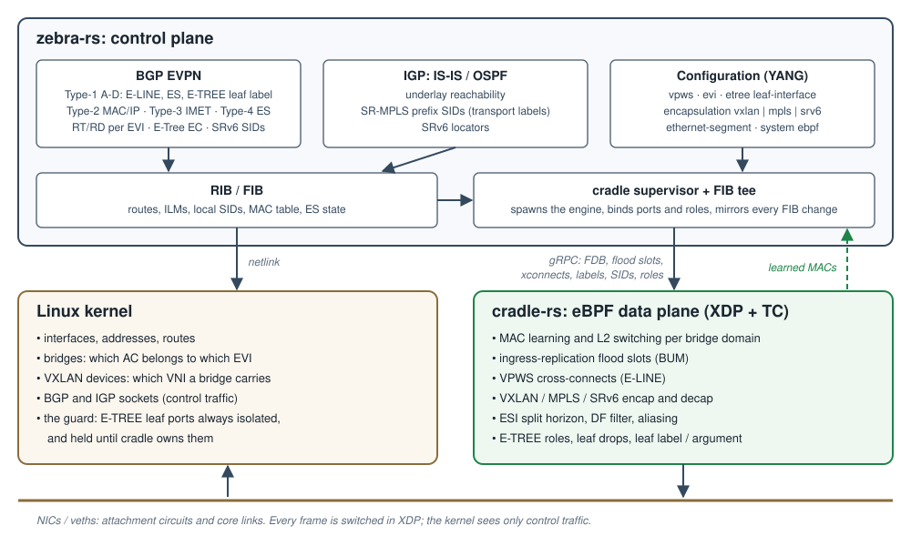
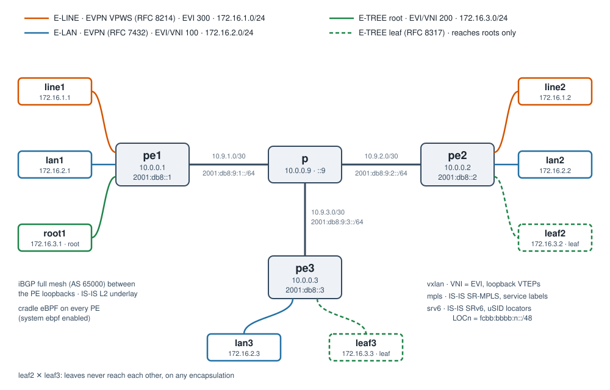

# EVPN E-LINE, E-LAN and E-TREE over VXLAN, SR-MPLS and SRv6, on Linux

*zebra-rs 26.10.2 · cradle-rs 1.1.9 · October 2026*

Ethernet services come in three shapes, which MEF calls **E-LINE**,
**E-LAN** and **E-TREE**. Operators carry them over three kinds of core:
**VXLAN** in the data centre, **MPLS** (today mostly SR-MPLS) in the WAN,
and **SRv6** where many cores are heading. That makes nine combinations.

On Linux, all nine now run with **zebra-rs** as the control plane and
**cradle-rs** as an eBPF data plane, on a stock kernel and from one
configuration model. Moving the services to another encapsulation is a
small config change: the `encapsulation vxlan | mpls | srv6` knob, plus
the underlay that encapsulation needs.

This post covers:

* the architecture;
* one sample topology that carries all three services at once;
* how its configuration changes with the encapsulation;
* what the services look like on the wire.

Each step uses the same topology, which ships as three playsets you can
run on a laptop.

## Three services, one control plane

EVPN (BGP L2VPN/EVPN, AFI 25 / SAFI 70) signals all three services. Each
one is an EVPN instance (EVI) with its own route distinguisher and route
target. They differ in which routes they use, and in what the data plane
does with a frame:

| Service | Shape | EVPN mechanism | What BGP carries |
|:--|:--|:--|:--|
| **E-LINE** | point to point: a virtual wire between two ACs | EVPN VPWS, RFC 8214 | one Ethernet A-D route (Type-1) per end, with the service ID as its Ethernet Tag. No MAC learning: whatever enters one AC leaves the other |
| **E-LAN** | multipoint: a virtual LAN | EVPN, RFC 7432 / RFC 8365 | MAC/IP routes (Type-2) for learned MACs, and an Inclusive Multicast route (Type-3, IMET) per PE, which builds the flood list for broadcast, unknown unicast and multicast (BUM) |
| **E-TREE** | rooted multipoint: hubs and spokes | EVPN E-Tree, RFC 8317 | an E-LAN where every attachment circuit (AC) is a **root** or a **leaf**. A leaf talks to roots only, never to another leaf. Leaf MACs carry the E-Tree extended community, and the leaf's BUM is marked so that remote PEs keep it away from their own leaves |

(AC, attachment circuit: the port a customer device connects to.)

The EVPN machinery is the same for all three: route types, RD/RT import
and export, MAC mobility, duplicate-address detection, and multihoming
with Ethernet Segments and DF election. zebra-rs implements it once,
independently of the encapsulation. The encapsulation decides only what
the **service identifier** is on the wire:

| | VXLAN (RFC 8365) | MPLS (RFC 7432) | SRv6 (RFC 9252) |
|:--|:--|:--|:--|
| Service identifier | 24-bit VNI | MPLS service label | SRv6 SID: End.DX2 (E-LINE), End.DT2U / End.DT2M (E-LAN, E-TREE) |
| Signalled as | VNI in the label field, plus the Encapsulation EC (tunnel type 8) | label in the label field, with no Encapsulation EC (absent means MPLS) | SRv6 L2 Service TLV in the BGP Prefix-SID attribute |
| Underlay | any IP network | LSPs: IS-IS SR-MPLS here | IPv6 with SRv6 locators: IS-IS SRv6 here |
| E-TREE leaf BUM mark | none on the wire: leaf-only PEs colour their IMET and get no leaf BUM | the egress PE's **leaf label** under the BUM label | the egress PE's **leaf argument** on its End.DT2M SID |

## Why the kernel needs help

zebra-rs can run one of the nine cells on the kernel alone: an E-LAN over
VXLAN, as a bridge plus a VXLAN device. Across the rest of the matrix the
kernel is missing pieces:

* no action that pops an MPLS label into a bridge or onto a port;
* no SRv6 behaviour that decapsulates into a bridge domain (End.DT2U,
  End.DT2M);
* no way to keep two leaves apart across the core, or to tell a leaf's
  broadcast from a root's;
* no per-segment split horizon or DF filtering for multihoming.

**cradle-rs** fills those gaps. It is an eBPF data plane, XDP plus TC
programs and their maps, which zebra-rs spawns and programs. With it,
the full matrix looks like this:

| | VXLAN | MPLS | SRv6 |
|:--|:--|:--|:--|
| **E-LINE** | ✅ cradle | ✅ cradle | ✅ cradle |
| **E-LAN** | ✅ kernel **or** cradle | ✅ cradle | ✅ cradle |
| **E-TREE** | ✅ cradle | ✅ cradle | ✅ cradle |

## Architecture



**zebra-rs** is the routing suite: BGP with EVPN, IS-IS and OSPF with
Segment Routing (SR-MPLS and SRv6), a RIB, and one YANG-modelled
configuration. With `system ebpf enabled`, its **cradle supervisor**
spawns the engine (`/usr/bin/cradle`) and binds every interface marked
`ebpf enabled` to it. Each such port gets its bridge domain, and each
leaf its E-TREE role. The **FIB tee** then mirrors every forwarding
change to the engine over gRPC:

| What zebra-rs knows | What cradle gets |
|:--|:--|
| a remote MAC (Type-2) | a remote FDB entry: VTEP + VNI, PE + label, or End.DT2U SID |
| a remote PE in an EVI (Type-3) | an ingress-replication flood slot toward it |
| a VPWS service | a cross-connect: AC ⇄ remote endpoint |
| a transport route (IGP) | the FIB entry the encapsulation resolves through |
| an EVI label or a local SID | the decapsulation into the right bridge domain or AC |
| an E-TREE leaf, a remote leaf label or argument | the port role, and the leaf mark on the right flood slots |

**cradle-rs** does the forwarding in XDP: MAC learning and switching per
bridge domain, flooding, cross-connects, and VXLAN, MPLS and SRv6
encapsulation and decapsulation, plus the multihoming and E-TREE filters.
It reports every MAC it learns back to zebra-rs, which advertises it as a
Type-2. That loop is how EVPN learns MACs with no kernel bridge in the
path.

**The kernel** keeps doing what it is good at. It owns the interfaces and
addresses, and it runs the BGP and IS-IS sockets: XDP hands control
traffic up to the stack. Its bridges and VXLAN devices remain the
configuration objects that say which AC belongs to which EVI and which
VNI a bridge carries. The kernel bridge also acts as a safety net for
E-TREE: a leaf port is always `isolated` there, and it is held in the STP
`listening` state until cradle has taken it over with its role.

## The sample topology



Three PEs hang off a P router. Every PE runs zebra-rs with cradle, and
the PEs peer in an iBGP full mesh (AS 65000) between their loopbacks. Each
CE is a plain Linux host with nothing EVPN-aware on it:

| Service | EVI | CEs | Subnet |
|:--|:--|:--|:--|
| E-LINE | 300 | `line1` (pe1) ↔ `line2` (pe2) | 172.16.1.0/24 |
| E-LAN | 100 | `lan1` (pe1), `lan2` (pe2), `lan3` (pe3) | 172.16.2.0/24 |
| E-TREE | 200 | `root1` (pe1, root), `leaf2` (pe2, leaf), `leaf3` (pe3, leaf) | 172.16.3.0/24 |

pe1 is the E-TREE's root site, and pe2 and pe3 are leaf sites. The two
leaves sit behind different PEs, so keeping them apart is the core's job,
not just a local bridge filter. P runs only the IGP. It carries no BGP
and no EVPN state; it forwards IP, label-switches or routes SIDs,
depending on the core.

| Node | IPv4 cores (VXLAN, MPLS) | IPv6 core (SRv6) |
|:--|:--|:--|
| pe*n* loopback | 10.0.0.*n*/32 (MPLS SID index *n*) | 2001:db8::*n*/128, locator fcbb:bbbb:*n*::/48 |
| p loopback | 10.0.0.9/32 | 2001:db8::9/128 |
| pe*n* — p link | 10.9.*n*.0/30 | 2001:db8:9:*n*::/64 |

## Configuration

Here is pe2 over VXLAN, the PE that carries all three services and a
leaf. This is the whole service configuration; the IS-IS and BGP session
statements around it are ordinary.

```yaml
system:
  ebpf:
    enabled: true             # spawn and program the cradle engine
interface:
- if-name: pe2-line2          # E-LINE AC: in no bridge
  ebpf:
    enabled: true
- if-name: pe2-lan2           # E-LAN AC
  bridge: br100
  ebpf:
    enabled: true
- if-name: pe2-leaf2          # E-TREE AC
  bridge: br200
  ebpf:
    enabled: true
bridge:
- name: br100
- name: br200
vxlan:
- name: vxlan100
  vni: 100
  local-address: 10.0.0.2
  bridge: br100
- name: vxlan200
  vni: 200
  local-address: 10.0.0.2
  bridge: br200
router:
  bgp:
    afi-safi:
    - name: evpn
      advertise-all-vni: true # E-LAN and E-TREE: Type-2/Type-3 per VNI
      vpws:                   # E-LINE
      - name: eline1
        evi: 300
        local-service-id: 2
        remote-service-id: 1
        interface: pe2-line2
      etree:                  # E-TREE: name the leaves; the rest are roots
        leaf-interface:
        - name: pe2-leaf2
```

Three things to note:

* **E-LINE** is one `vpws` entry: an EVI, the two service IDs, and the AC.
* **E-LAN** is a bridge holding its AC and a VXLAN device.
  `advertise-all-vni` originates its routes.
* **E-TREE** is an E-LAN plus one `etree leaf-interface` statement. Roles
  are **per AC**, so one EVI on one PE can mix roots and leaves, and a PE
  whose ACs are all roots (pe1 here) needs no E-TREE configuration at
  all. A leaf needs cradle, and zebra-rs refuses a leaf AC at commit
  without it.

### Switching to MPLS

This is the complete diff of pe2, VXLAN to MPLS:

```diff
 bridge:
 - name: br100
 - name: br200
-vxlan:
-- name: vxlan100
-  vni: 100
-  local-address: 10.0.0.2
-  bridge: br100
-- name: vxlan200
-  vni: 200
-  local-address: 10.0.0.2
-  bridge: br200
 router:
   isis:
     ...
+    segment-routing: mpls
+    te-router-id: 10.0.0.2
     interface:
     - if-name: lo
       ipv4:
         enabled: true
+        prefix-sid:
+          index: 2
   ...
     - name: evpn
       advertise-all-vni: true
+      encapsulation: mpls
+      evi:
+      - id: 100
+        bridge: br100
+      - id: 200
+        bridge: br200
       vpws:
```

The changes:

* IS-IS turns on SR-MPLS and gives the loopback a prefix SID: that is the
  transport.
* `encapsulation mpls` replaces VNIs with service labels.
* With no VXLAN device left to declare a VNI, the `evi` list ties each
  bridge to its EVI.

The `vpws` and `etree` blocks do not change. No label appears anywhere:
zebra-rs draws every service label, and every E-TREE leaf label, from its
dynamic label block.

### Switching to SRv6

Over SRv6 the core is IPv6, and each PE carves its SIDs from a uSID
locator:

```yaml
segment-routing:
  locator:
  - name: LOC2
    prefix: fcbb:bbbb:2::/48
    behavior: usid
router:
  isis:
    segment-routing:
      srv6:
        locator: LOC2         # advertise the locator in IS-IS
  bgp:
    segment-routing:
      srv6:
        locator: LOC2         # carve the EVPN service SIDs from it
    afi-safi:
    - name: evpn
      advertise-all-vni: true
      encapsulation: srv6
      vpws: ...               # unchanged
      etree: ...              # unchanged
```

The VXLAN devices stay. Their job here is to tell zebra-rs which VNI each
bridge carries. cradle forwards everything, so the kernel devices never
see a frame.

## On the wire

All three labs pass the same checks: every service pings end to end, and
the two leaves cannot reach each other.

| | VXLAN | MPLS | SRv6 |
|:--|:--|:--|:--|
| E-LINE line1 ↔ line2 | ✅ | ✅ | ✅ |
| E-LAN lan1 ↔ lan2, lan1 ↔ lan3, lan2 ↔ lan3 | ✅ | ✅ | ✅ |
| E-TREE root1 ↔ leaf2, root1 ↔ leaf3 | ✅ | ✅ | ✅ |
| E-TREE leaf2 ↔ leaf3 | ✖ blocked | ✖ blocked | ✖ blocked |

### What BGP carries

On pe1 over VXLAN, one route per kind (abridged):

```
pe1>show bgp evpn
Route Distinguisher: 10.0.0.1:300
 *>  [1]:[00:00:00:00:00:00:00:00:00:00]:[1]
                    10.0.0.1                   0         32768 i
                    Extended community: RT:65000:300 ET:8 l2-attr:P:mtu0
Route Distinguisher: 10.0.0.2:100
 *>  [2]:[0]:[48]:[02:00:00:00:02:02]
                    10.0.0.2                   0    100      0 i
                    Extended community: RT:65000:100 ET:8
Route Distinguisher: 10.0.0.2:200
 *>  [2]:[0]:[48]:[02:00:00:00:03:02]
                    10.0.0.2                   0    100      0 i
                    Extended community: RT:65000:200 ET:8 etree:leaf
 *>  [3]:[0]:[32]:[10.0.0.2]
                    10.0.0.2                   0    100      0 i
                    Extended community: RT:65000:200 ET:8 etree:leaf
                    PMSI: ingress-replication endpoint:10.0.0.2 vni:200
```

* The **E-LINE** end is a Type-1 with the L2-Attributes EC (`P`:
  primary).
* The **E-LAN** MAC is a plain Type-2.
* The **E-TREE** MAC behind leaf2 carries `etree:leaf`, and so does pe2's
  IMET, because every AC of EVI 200 on pe2 is a leaf.

The same services over SRv6 carry SIDs instead of VNIs (abridged
further):

```
Route Distinguisher: 10.0.0.2:200
 *>  [2]:[0]:[48]:[02:00:00:00:03:02]
                    2001:db8::2                0    100      0 i
                    Remote SID: fcbb:bbbb:2:44:: (End.DT2U)
                    Extended community: RT:65000:200 ET:8 etree:leaf
 *>  [3]:[0]:[128]:[2001:db8::2]
                    2001:db8::2                0    100      0 i
                    Remote SID: fcbb:bbbb:2:42:: (End.DT2M)
Route Distinguisher: 10.0.0.2:300
 *>  [1]:[00:00:00:00:00:00:00:00:00:00]:[2]
                    2001:db8::2                0    100      0 i
                    Remote SID: fcbb:bbbb:2:40:: (End.DX2)
```

### E-TREE, known unicast: dropped where it enters

pe2 learns from leaf3's coloured Type-2 that leaf3's MAC is behind a
leaf. So when leaf2 sends to that MAC, pe2's engine drops the frame
before encapsulating it. This works the same under all three
encapsulations:

```shell
$ sudo ip netns exec leaf2 ip neigh replace 172.16.3.3 lladdr 02:00:00:00:03:03 dev leaf2-pe2
$ sudo ip netns exec leaf2 ping -c 3 172.16.3.3
3 packets transmitted, 0 received, 100% packet loss
```

```
pe2>show ebpf stats
...
l2_drop_etree_uc 3
```

### E-TREE, BUM: three ways to mark a leaf

BUM is harder. A single copy to a PE serves every AC behind it, roots and
leaves alike, so the ingress PE cannot drop it. RFC 8317 instead marks a
leaf's copy, and the egress PE delivers a marked copy to its roots only.
Each encapsulation carries the mark differently.

**MPLS: a leaf label.** This is RFC 8317 §4.2 as written. Each PE with a
leaf AC draws one extra label and advertises it on an Ethernet A-D route
with ESI 0:

```
Route Distinguisher: 10.0.0.2:0
 *>  [1]:[00:00:00:00:00:00:00:00:00:00]:[4294967295]
                    10.0.0.2                   0    100      0 i
                    Extended community: RT:65000:200 etree:leaf-label:24003
```

A leaf's BUM copy toward pe3 carries pe3's leaf label under the BUM
label. pe3 pops it and keeps the copy away from leaf3. The counters on
the two PEs match one for one:

```
pe2>show ebpf stats              pe3>show ebpf stats
mpls_l2_leaf_push 15             mpls_l2_leaf_pop 15
                                 l2_drop_etree_bum 15
```

**SRv6: a leaf argument.** The label's SRv6 counterpart is an argument on
the egress PE's End.DT2M SID: Arg.FE2 from RFC 9252, placed after the
function as RFC 9819 specifies. pe3 advertises argument 1. A capture on P
of one ARP broadcast from leaf2 shows the two copies pe2 sends:

```
p-pe2 In  IP6 2001:db8::2 > fcbb:bbbb:3:41:1::: ARP, Request who-has 172.16.3.1 tell 172.16.3.2
p-pe2 In  IP6 2001:db8::2 > fcbb:bbbb:1:42::: ARP, Request who-has 172.16.3.1 tell 172.16.3.2
```

The copy to pe3 goes to its End.DT2M **with argument 1**, so pe3 delivers
it to roots only. The copy to pe1 goes to pe1's End.DT2M with no
argument: pe1 has no leaves, and root1 must receive the broadcast.

**VXLAN: a coloured IMET.** VXLAN has no spare bits to carry a mark, and
no standard exists for E-TREE BUM over VXLAN. zebra-rs uses the wire
format of Arista's draft-bamberger-bess-imet-filter-evpn-etree-vxlan, and
adds one egress rule of its own:

* a PE whose ACs in an EVI are all leaves colours its IMET;
* a leaf's BUM is **not sent** to such a PE at all;
* BUM arriving **from** such a PE goes to roots only.

The capture shows the difference. An E-LAN broadcast from lan2 leaves
pe2 as two copies:

```
p-pe2 In  IP 10.0.0.2.65021 > 10.0.0.3.4789: VXLAN, flags [I] (0x08), vni 100
p-pe2 In  IP 10.0.0.2.65021 > 10.0.0.1.4789: VXLAN, flags [I] (0x08), vni 100
```

leaf2's broadcast leaves as one, and leaf-only pe3 gets nothing:

```
p-pe2 In  IP 10.0.0.2.65021 > 10.0.0.1.4789: VXLAN, flags [I] (0x08), vni 200
```

This is exact as long as each EVI has at most one PE that mixes roots and
leaves. `show bgp evpn etree` warns about any EVI where that does not
hold.

## Try it yourself

Install zebra-rs on Ubuntu 22.04, 24.04 or 26.04 (x86_64 or arm64). The
package pulls in cradle-rs as a recommended dependency:

```shell
curl -fsSL https://zebra.rs/install.sh | bash
```

The three labs are in the `playset/` directory of the source tree. They
ship in the package's `/usr/share/zebra-rs/playset/` from the next
release on. Each lab builds its routers and hosts out of Linux network
namespaces and veth pairs, and runs a zebra-rs daemon per node:

```shell
$ git clone https://github.com/zebra-rs/zebra-rs.git
$ cd zebra-rs/playset/bgp-evpn-services-vxlan     # or -mpls, -srv6
$ ./up.sh
$ sudo ip netns exec leaf2 ping 172.16.3.1         # leaf → root: works
$ sudo ip netns exec leaf2 ping 172.16.3.3         # leaf → leaf: never
$ sudo ip netns exec pe2 vty
pe2>show bgp evpn etree
$ ./down.sh
```

| Lab | Walkthrough |
|:--|:--|
| `bgp-evpn-services-vxlan` | [README](https://github.com/zebra-rs/zebra-rs/tree/main/playset/bgp-evpn-services-vxlan) |
| `bgp-evpn-services-mpls` | [README](https://github.com/zebra-rs/zebra-rs/tree/main/playset/bgp-evpn-services-mpls) |
| `bgp-evpn-services-srv6` | [README](https://github.com/zebra-rs/zebra-rs/tree/main/playset/bgp-evpn-services-srv6) |

The labs need root, for namespaces and XDP. They were captured on
Ubuntu 24.04 (Linux 6.8, arm64). One veth detail: the P router forwards
in the kernel in the VXLAN and SRv6 labs, and a veth delivers an
XDP-redirected frame only when its peer end runs NAPI. So `up.sh` turns
GRO on for P's veths. Physical NICs need nothing of the kind.

## Limits worth knowing

* **E-TREE over VXLAN has no standard.** zebra-rs speaks the Arista draft
  form, and treats the IMET form of draft-ietf-bess-rfc8317bis as a root's.
  It is exact unless two or more PEs in an EVI mix roots and leaves, and
  `show bgp evpn etree` warns when that happens.
* **E-TREE is an L2 property.** An IRB address on a leaf's bridge routes
  between leaves, so `show bgp evpn etree` warns about it. A P2MP tunnel
  or Assisted Replication on an E-TREE EVI is not marked: use ingress
  replication, as the labs do.
* **E-LINE** has no all-active load balancing across a multihomed remote
  yet, and no MPLS control word.
* **Interoperability:** FRR has no E-TREE. zebra-rs's E-TREE has been
  tested against zebra-rs only. Labs against vendors that document E-TREE
  (Arista over VXLAN, Nokia and Juniper over MPLS) have not been run yet.

## Further reading

The zebra-rs book covers each piece in depth:

* [EVPN VPWS (E-LINE)](https://github.com/zebra-rs/zebra-rs/blob/main/book/src/ch-02-38-bgp-evpn-vpws.md)
* [EVPN over MPLS](https://github.com/zebra-rs/zebra-rs/blob/main/book/src/ch-02-40-bgp-evpn-mpls.md)
* [EVPN over SRv6](https://github.com/zebra-rs/zebra-rs/blob/main/book/src/ch-02-41-bgp-evpn-srv6.md)
* [EVPN E-Tree](https://github.com/zebra-rs/zebra-rs/blob/main/book/src/ch-02-47-bgp-evpn-e-tree.md)

EVPN multihoming (all-active and single-active Ethernet Segments, DF
election, split horizon) composes with all of the above, on all three
encapsulations.
